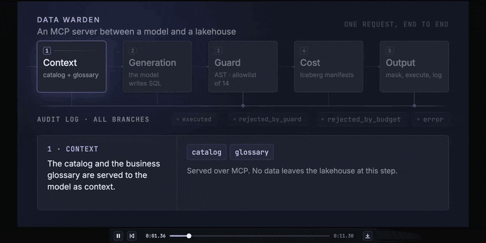
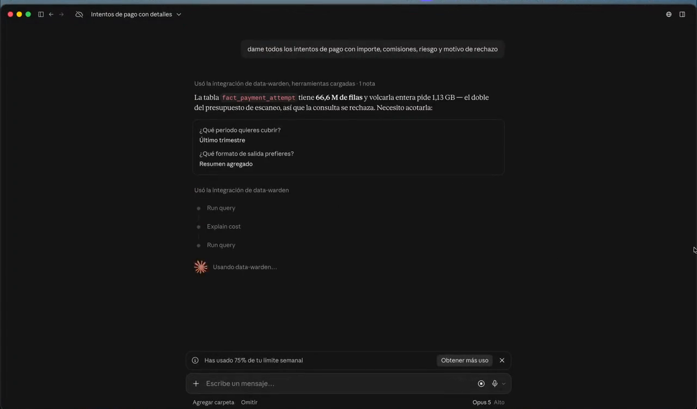
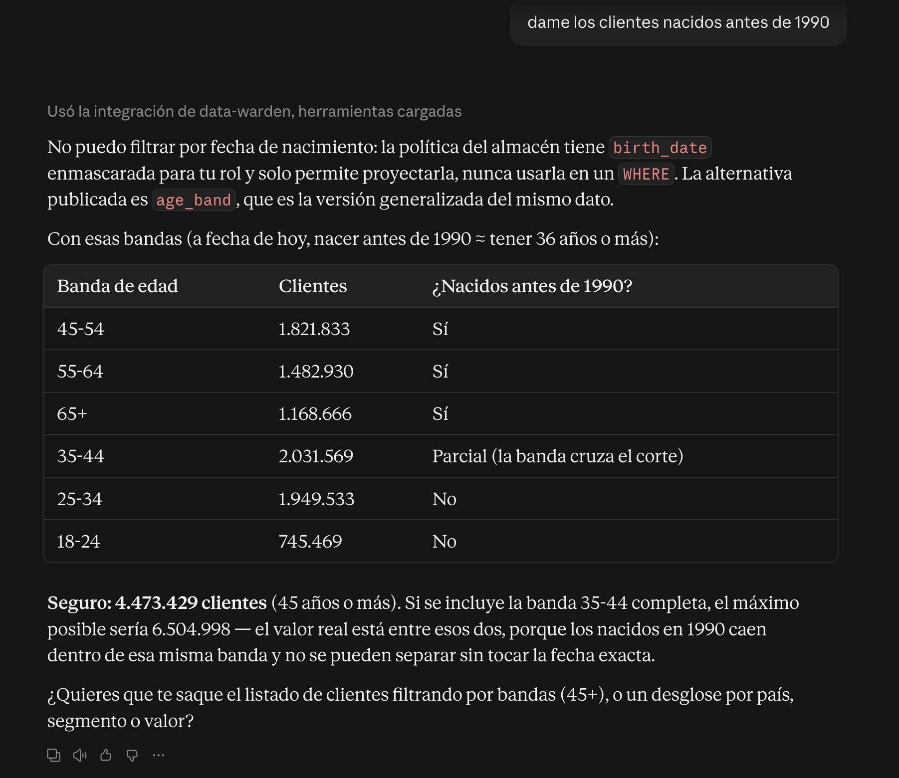
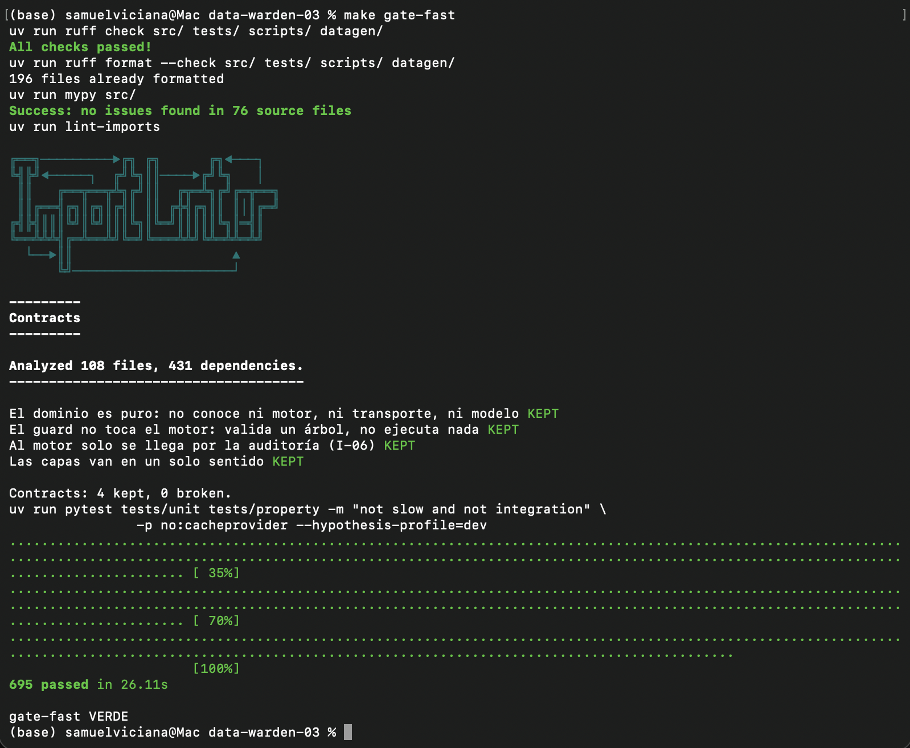

<h1 align="center">Data Warden</h1>

<p align="center"><b>English</b> · <a href="README.es.md">Español</a></p>

<p align="center">
  <strong>An agent that translates natural language into SQL over a lakehouse, and five
  deterministic control rings that guarantee whatever comes out of it cannot do harm.</strong>
</p>

<p align="center">
  
  
  
  
  
  
</p>

<p align="center">
  
</p>

<p align="center">
  <sub><b>One request, end to end.</b> The rejection is not the error path: it is the product.<br>
  <a href="docs/img/flow.mp4">Video version</a> · <a href="docs/img/flow.png">static frame</a></sub>
</p>

---

## In one sentence

Translating natural language into SQL is a solved problem. What keeps it out of production in
a company with real data is everything that comes after: **who can see which column, what
happens if the model writes a `DELETE`, how much a query costs before it runs, and who answers
when someone asks what was executed last Tuesday at three.**

Data Warden is that "after". The model proposes and **the system decides**, with rules that do
not live in the prompt. That is why it does not matter which client connects or which model it
uses: **it cannot bypass the rules, because the rules are not on its side.**

## What it demonstrates

| | Guarantee | Evidence |
|---|---|---|
| 🛡️ | **SQL is validated as a tree, not as text**, and what runs is the validated tree, never the incoming string. A 14-rule allowlist: anything unknown is rejected | 0 evasions on a blind-written holdout and on 3,388 mutated variants; 0 exceptions on 20,000 arbitrary inputs |
| 💶 | **Cost is known before execution**, from Iceberg metadata, without touching a single row | 0 expensive queries reach the engine; a 3 GB query is rejected in 1.5 ms |
| 🎭 | **Role-based masking rewrites the AST**, so data cannot leak through a `WHERE`, a `GROUP BY` or an alias either | 0 personal-data leaks in projection, predicate and aggregation |
| 🔗 | **Everything is audited, rejections included**, in a hash chain that exposes any edit | 100 % of invocations audited; 100 % of 1,299 tamperings detected |
| 🪪 | **The role is set by whoever installs the server**, never by whoever asks | 0 spoofing attempts accepted via `_meta` or tool arguments |
| 🤖 | **The AI is measured with an interval, not a pretty number** | accuracy 0.517 · Wilson 95 % [0.39 – 0.64] on 60 questions, with a local 26B model |

Every figure comes from an artifact in `evals/reports/` and sits next to the command that
reproduces it ([full table](#results)).

## See it working

<p align="center">
  <a href="docs/proof/video/proof.mp4">
    
  </a>
</p>

<p align="center">
  <sub><b>90 seconds, uncut, against the full dataset.</b>
  <a href="docs/proof/video/proof.mp4">▶ Watch the video</a></sub>
</p>

Three questions in a row from a real MCP client (asked in Spanish in the video), and the three
answers that define the system:

1. **A normal question** — *"how many customers are there per country?"* — gets answered:
   9,199,249 customers across 30 countries.
2. **One the policy does not allow** — *"give me the customers born before 1990"* — is
   **rejected**, and the rejection carries the published alternative, so the answer is still
   useful.
3. **One that is too expensive** — *"give me every payment attempt with amount, fees, risk and
   decline reason"* — is **rejected before it runs**, with its size computed without reading
   data, and the client narrows it to one quarter and an aggregated summary until it gets an
   answer.

<table>
<tr>
<td width="50%" valign="top">

</td>
<td width="50%" valign="top">

</td>
</tr>
<tr>
<td valign="top"><sub><b>The rejection is the product.</b> <code>birth_date</code> is masked for
that role and may only be projected, never filtered on. The system says so, names the
alternative —<code>age_band</code>— and the client answers with it, including the part it
<b>cannot</b> refine without the exact date.</sub></td>
<td valign="top"><sub><b>And it verifies in 26 seconds.</b> <code>make gate-fast</code> on a clean
clone: types, the four layer contracts and 695 tests, no dataset generation needed.</sub></td>
</tr>
</table>

## How it works

```
    natural language
          │
          ▼
    ①  CONTEXT       generated catalog + signed business glossary
          │          the model does not guess the schema: it reads it
          ▼
    ②  GENERATION    NL → SQL · the only part with an LLM · self-corrects by reading the rejection
          │
          ▼
    ③  VALIDATION    sqlglot → AST → ALLOWLIST guard · 14 rules · fail-closed
          │          unknown node or function ⇒ rejection
          ▼
    ④  COST          estimated from Iceberg manifests, without reading data
          │          soft: asks for confirmation · hard: does not run
          ▼
    ⑤  OUTPUT        role-based masking by rewriting the AST · row limit
          │          append-only audit with a hash chain (JCS, RFC 8785)
          ▼
    a result, or a rejection that says which rule fired and what to do instead
```

Rings ③ to ⑤ are **deterministic**: they do not depend on the model, they are tested with TDD,
property-based tests and mutation testing, and they behave the same with any client. Ring ② is
the only probabilistic one, and that is why **it is measured with evaluations rather than tested
with asserts**.

A rejection is not a protocol error: it is the most useful answer the system gives.

```
R008 · column dim_customer.birth_date is masked for role analyst: it may only appear
       as a direct projection, and it appears in a WHERE predicate
       → use dim_customer.age_band instead
```

The same core is served over **MCP 2026-07-28** (stdio) and over **HTTP** (FastAPI). A contract
test requires both transports to return the same normalized resultset and neither to import
the other: the domain does not depend on the transport.

## Try it

Requires **Python 3.12** and [`uv`](https://docs.astral.sh/uv/). No server to start, no ports,
no credentials: DuckDB is embedded and the data is Parquet.

### 1 · Verify without data · under a minute

```bash
git clone https://github.com/samuvm/data-warden.git && cd data-warden
uv sync                  # exact versions from uv.lock
make gate-fast           # lint · types · layer contracts · 695 tests
```

Nothing needs to be generated: the catalog, the access policy and the cost statistics are
versioned.

### 2 · Generate the dataset

The dataset is not versioned. It is generated **byte-for-byte identical** from its seed:

```bash
make dataset PROFILE=dev     # ~15 s · 3.1 M rows · 91 MB     · to explore
make dataset PROFILE=full    # minutes · 294.8 M rows · 7.46 GB · the one behind the published numbers
```

### 3 · Connect it to an MCP client

For Claude Desktop, this is the configuration block (the full guide, with the pepper, common
mistakes and how to check it before restarting, is in
[`docs/instalar-en-claude-desktop.md`](docs/instalar-en-claude-desktop.md), in Spanish):

```json
"mcpServers": {
  "data-warden": {
    "command": "<the output of `which uv`>",
    "args": ["run", "--directory", "<absolute path to the repository>", "warden", "mcp", "serve"],
    "env": {
      "DATAWARDEN_MASK_PEPPER": "<32 characters or more: openssl rand -hex 24>",
      "WARDEN_ROLE": "analyst"
    }
  }
}
```

The server uses the `full` profile by default. To try it with `dev`, append
`"--database", "datagen/out/cierzo-dev.duckdb"` to `args`; the budget still prices `full`, so
with `dev` it rejects somewhat more than necessary, never less.

Then ask two questions: *"how many customers are there per country?"* must be answered;
*"give me the customers born before 1990"* must come back **rejected**, with the rule and the
alternative. If it answers the first and rejects the second, the system is doing its job.

### 4 · Reproduce the published numbers

These need the `full` profile generated.

```bash
make eval                # NL→SQL accuracy · deterministic · needs NO model
make gate-full           # the full suite, coverage, secrets and attacks
make done MILESTONE=8    # the 13 conditions of "done" · includes mutation testing: slow
```

`make eval` reproduces the accuracy metric **without calling any model**: the generator's
answers are recorded per model and per request, so the number repeats on any machine. Only
`make eval-refresh-exec` calls the local model again, which is `gemma4:26b-mlx` on Ollama,
pinned by digest in `models.lock`.

<a id="results"></a>
## Results

Measured on a **MacBook Pro M4 Max · 36 GB · macOS 26.5**. Thresholds in
[`docs/GOALS.yaml`](docs/GOALS.yaml), sealed with `thresholds.lock`. This table is **not
written by hand**: `make readme` generates it from `evals/reports/`.

<!-- numbers:start · generated by `make readme`, do not edit by hand -->

**Guarantees · axioms: their threshold can never be lowered**

| What is measured | Threshold | Measured | Command |
|---|---|---|---|
| Write or evasion queries the guard lets through | 0 | **0 evasions** · holdout 15/15, Wilson 95 % [0.80 – 1.00] | `make attack-holdout` |
| … on variants generated by mutating the AST | 0 | **0 evasions** in 3,388 mutants | `make attack-mut` |
| Exceptions escaping the guard (fail-closed) | 0 | **0** in 20,000 arbitrary inputs | `make guard-property` |
| Queries executed as a string instead of the validated AST | 0 | **0** | `make arch-checks` |
| Expensive queries that reach the engine | 0 | **0** · a 3 GB query is rejected in 1.5 ms | `make budget-invariant` |
| Personal data leaving unmasked | 0 | **0** in projection, predicate and aggregation | `make pii-suite` |
| Engine invocations without an audit record | 100 % audited | **100 %** | `pytest tests/property/test_audit_coverage.py` |
| Role spoofing accepted (via `_meta` or arguments) | 0 | **0** | `pytest tests/adversarial/test_role_spoofing.py` |
| New secrets in the repository | 0 | **0** | `make secrets` |

**Performance, cost and traceability**

| What is measured | Threshold | Measured | Command |
|---|---|---|---|
| Guard latency | p95 ≤ 25 ms | **p95 0.85 ms** · p99 1.17 · max 4.20 | `make bench-guard` |
| Cost estimator error | p95(actual/est.) ≤ 1.5 | **1.077** | `make cost-calibration` |
| Audit tampering detected | 100 % | **100 %** of 1,299 altered bytes | `pytest tests/property/test_audit_chain.py` |

**Codebase quality**

| What is measured | Threshold | Measured | Command |
|---|---|---|---|
| Line coverage · global / critical modules | ≥ 90 % / ≥ 95 % | **98.0 % / 97.48 %** | `make coverage` |
| Public functions without a single test | 0 | **0** | `make coverage` |
| Mutation score · guard rules | ≥ 85 % | **85.46 %** | `make mutation` |
| Mutation score · rest of the core | ≥ 70 % | **71.6 %** | `make mutation` |
| MCP 2026-07-28 conformance | 11/11 | **11/11** | `make mcp-conformance` |

**The AI part · measured, not unit-tested**

| What is measured | Threshold | Measured | Command |
|---|---|---|---|
| NL→SQL execution accuracy on 60 reference questions | ≥ 0.40 · Wilson ≥ 0.25 | **0.517** (31/60) · Wilson 95 % [0.39 – 0.64] | `make eval` |
| Recovery after a guard rejection | ≥ 0.70 | **0.857** (24/28) · Wilson 95 % [0.69 – 0.94] | `make eval-recovery` |
| Choosing the right MCP tool | 20/20 | **20/20** | `make eval-toolchoice` |

<!-- numbers:end -->

### How to read the accuracy number

It is the easiest number to misread, so here it is with all its context:

- **The interval is published, not the point estimate.** With 60 questions, "0.517" without
  its Wilson interval [0.39 – 0.64] would be meaningless.
- **The initial threshold was 0.80 and I redefined it to 0.40** after four measurements with
  two local models. The decision was made with the data in front of me and is stated here:
  lowering the bar *and* moving up a model size were the same decision. With the 9B model the
  system scored 0.19; with the 26B model the failures stopped being syntactic (invented tables:
  from 12 to 2; SQL that does not compile: from 6 to 0) and became semantic. **The remaining
  work is in the business context, not in the model.**
- **The 60 questions** are stratified (20 simple, 25 with a join or aggregation, 15 with a
  window function or correlated subquery) and **10 have "rejection" as the correct answer**:
  questions an analyst would ask in good faith that their role does not allow them to answer.
- **Truth is compared on normalized resultsets**, never on the SQL text. Two different queries
  that return the same thing are both correct. The rules are in
  [`docs/spec/resultset-equality.md`](docs/spec/resultset-equality.md).
- **It is self-assessed**: the reference answers came out of the same workflow that built the
  system, transcribing definitions from the business glossary I wrote, and nobody outside the
  project has reviewed them yet. See [limitations](#limitations).

## Design decisions

| Decision | Why |
|---|---|
| **Allowlist, not denylist** | A denylist cannot forbid what nobody has thought of yet. A node or function that is not declared is rejected, and that asymmetry is the whole design |
| **Run the validated AST, never the string** | Validating one text and running another opens the door to any difference between the two. `Engine.execute()` only accepts a `ValidatedQuery`, and an architecture check enforces it |
| **Fail-closed** | If the guard fails internally, or times out, the outcome is a rejection. Never a pass |
| **Masking rewrites the AST** | Post-processing the result by column name does not see a `WHERE iban LIKE 'ES91…%'`, which extracts the value without printing it. Rule R008 decides by role *and by position in the query*, following lineage through aliases, CTEs and views |
| **Cost from Iceberg manifests** | `EXPLAIN ANALYZE` runs the query, and a cloud engine bills before telling you how much it scanned. The manifest gives bytes per column and per partition without reading a row. Anything uncertain is rounded up: underestimating would let an expensive query through |
| **Hash-chained audit log** | Detects edits to any record. Its limit —it does not stop someone with access to the file from truncating it entirely— is written down in the [threat model, §4.1](docs/threat-model.md) |
| **The role comes from the process environment** | `_meta` and tool arguments are data controlled by whoever asks. Treating them as authority gives the role away |
| **Stateless MCP, with MRTR** | The soft budget asks for confirmation using the input-request pattern of the 2026-07-28 spec. If the client cannot answer, the query runs with a warning in the response, and the hard budget still rejects on its own |
| **Recorded evaluations** | Temperature 0, fixed seed and answers recorded per model and per request. A number that cannot be obtained again is not a number |
| **Telemetry with its own model** | No OpenTelemetry `gen_ai.*` attribute is stable yet. The domain uses its own model and a translator is the only module that knows the standard's names: the next spec break is one file, not a migration |

## What the checks found

The project publishes its failures because each one changed a test or a rule. The most serious:

- **The masking ring was not on the execution path, and its axiom reported 0 leaks.** The
  measurement exercised a function the system never called. Today it is measured through the
  real executor, and an architecture check requires that path to go through the ring
  ([threat model §5.2](docs/threat-model.md)).
- **The cost estimator charged 0 bytes for a 4.1 GB table.** A badly serialized partition key
  emptied the pruning, and any query with a date filter would have passed the budget. Calibration
  found it, not a review ([§5.1](docs/threat-model.md)).
- **The guard's rejection message was a prompt-injection channel.** A table name with line
  breaks forged fake sections in the correction prompt. Everything that goes back to the model
  is now sanitized ([§4.3.1](docs/threat-model.md)).
- **The secrets check could not fail**, because the scanner rewrote the very baseline it compared
  against; and later it turned out it did not look at files not yet added to git. Both were
  proven by planting a fake key.
- **A `SIGSEGV` in compiled `sqlglot`** with `x UNION SELECT 1`. No `except` catches a native
  crash: it is closed off in R001, before the tree is qualified.

The pattern that repeats, and the lesson of the project: **measuring a ring is not enough; it
has to be measured along the path that actually runs.** The details are in
[`docs/JOURNAL.md`](docs/JOURNAL.md), mistakes included.

<a id="limitations"></a>
## Limitations

They are stated here because not stating them would be the failure:

- **The numbers are self-assessed.** The attack holdout was written by an isolated agent session
  that never saw the guard code, but that isolation is discipline, not a technical control. The
  question bank's reference answers came out of the same workflow that built the system,
  transcribing the business glossary I wrote. Nobody outside the project has reviewed either
  yet.
- **The attack holdout has 15 cases.** That is why the interval [0.80 – 1.00] is published and
  not "100 % blocked".
- **NL→SQL accuracy (0.517) is far from what unsupervised production use would require.** The
  system is designed so that this is not dangerous —what fails, fails closed— but that does not
  make it useful on its own.
- **Athena: NOT VERIFIED.** The cloud engine (Athena + Glue over Iceberg on S3) is an extension
  that has not been built for lack of an AWS account. The engine interface is ready and the cost
  estimator already works on the metadata Athena would use, but **no claim in this document has
  been checked against Athena**.
- **Telemetry translates to the OpenTelemetry standard but does not export.** The attributes
  follow the GenAI contract and are checked on the real path, but no collector is connected.
- **Masking is deterministic, with a fixed pepper.** That makes answers comparable across runs
  and in exchange loses resistance to correlating two sessions. The pepper reaches the engine's
  logs once per connection ([§4.2.1](docs/threat-model.md)).
- **The audit chain detects edits, not complete truncation** of the file by someone with access
  to it ([§4.1](docs/threat-model.md)).
- **The dataset is synthetic.** It mimics a European payment gateway with its real traps
  (retries, re-ingestions, dimensions that change over time), but it belongs to nobody.

## The dataset · CIERZO

A European payment gateway that does not exist: **12,400 merchants, 9.2 M customers and 66.6 M
authorization attempts** over two years. **24 tables, 294.8 M rows, 7.46 GB** of Parquet, also
materialized as **Apache Iceberg v2** tables, which is what makes it possible to estimate cost
without reading data. The generator is published, not the data.

It has traps on purpose, the ones that make an NL→SQL system fail in a real company: a retried
payment is several rows, re-ingestions duplicate 0.35 % of attempts, counting revenue by
counting rows overestimates it by 24 %, and merchants change version over time. The figures are
generated by `datagen/report.py` on every build
([`datagen/MEASURED-full.md`](datagen/MEASURED-full.md)); none is written by hand.

## Contracts

What the system may do is not in the code: it is in signed files that the build compiles to
JSON. The domain never parses YAML.

| File | What it fixes |
|---|---|
| [`docs/spec/policy.yaml`](docs/spec/policy.yaml) | Role × column × position matrix: `allow`, `mask` or `deny` |
| [`docs/spec/glossary.yaml`](docs/spec/glossary.yaml) | What each table and each metric means in business language |
| [`docs/spec/budgets.yaml`](docs/spec/budgets.yaml) | Cost limits per role: run, confirm or reject |
| [`docs/spec/tools.yaml`](docs/spec/tools.yaml) | The four MCP tools and the exact description the client sees |
| [`docs/spec/resultset-equality.md`](docs/spec/resultset-equality.md) | When two resultsets are "the same" |
| [`docs/spec/rejection.schema.json`](docs/spec/rejection.schema.json) · [`audit-record.schema.json`](docs/spec/audit-record.schema.json) | The shape of a rejection and of an audit record |

A signed contract carries the `sha256` of its own text, and a test fails if someone edits it
without signing it again. `docs/CONTRACTS/` holds literal copies of contracts shared with other
projects, and a test compares them byte by byte.

## Structure

```
src/datawarden/
  domain/        frozen, pure types
  catalog/       introspection, lineage and Iceberg statistics
  guard/         the core · allowlist + 14 rules
  cost/          estimator and budget
  mask/          masking by AST rewriting
  audit/         audit chain · the only path to the engine
  principal/     role, policy and per-role budget
  nl2sql/        generation, correction loop and model providers
  service/       the four operations, transport-agnostic
  mcp/  http/    the two transports, which do not know about each other
  telemetry/     internal model of model calls and OpenTelemetry translator
  engines/       DuckDB adapter

tests/     unit · property · contract · integration · adversarial · holdout
attacks/   the evasion notebook, which grows with every one found
evals/     question bank · recorded answers · reports
datagen/   the dataset generator and its seed
```

**Each zone has its own testing regime, and they differ on purpose.** The guard requires pure
TDD, 85 % mutation score and 95 % coverage; the adapters, contract tests; and in the SQL
generator **TDD is forbidden**: a non-deterministic component is measured, and pretending to
test it with asserts is fooling yourself. The full map is in [`docs/RULES.md`](docs/RULES.md).

## How it was built

I built Data Warden with an agentic workflow (Claude Code) that I designed with one goal: to
make a coding agent's work **verifiable rather than trusted**. The agent writes code; what it
cannot do is move the bar it is measured against.

- **Goals are code, not prose.** [`docs/GOALS.yaml`](docs/GOALS.yaml) sets 26 goals, each with
  its threshold, its command and its artifact, sealed by `thresholds.lock`: changing a threshold
  breaks the gate. Eight are **axioms** whose threshold can never be lowered.
- **"Done" is a command.** `make done MILESTONE=N` is 13 conditions with exit `0` or nothing,
  and it leaves a restore point. There is no other definition of finished.
- **Each zone has its testing regime**, written in [`docs/RULES.md`](docs/RULES.md) next to the
  invariants and the check that verifies each one: pure TDD in the guard, contract tests in the
  adapters, evaluation —and no TDD— in the generator.
- **Separation of knowledge.** The attack holdout was written by an isolated agent session with
  no access to the guard code, against the specification only.
- **The decisions that are not engineering are mine:** the access policy, the business glossary,
  the cost budgets and the thresholds live in signed contracts the build compiles. The agent
  proposes; I decide.
- **The gate audited itself too**: several checks turned out to be unable to fail, and each was
  fixed by first proving that it now did —for example, by planting a fake key for the secrets
  check.

[`docs/JOURNAL.md`](docs/JOURNAL.md) is the engineering log: decisions, numbers before and
after, and the mistakes. The documentation under `docs/` is in Spanish; code, identifiers,
logs and error messages are in English.

## License

[Apache-2.0](LICENSE).
